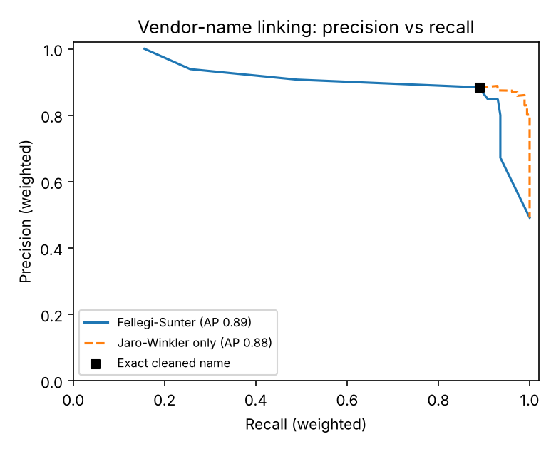
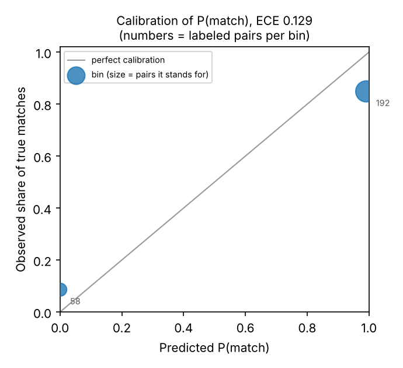

# Vendor entity linking on Canadian federal contracts

**Question.** The same company appears under many spellings in federal contract records
(`SUMMIT DATA SOLUTIONS INC.`, `Summit Data Solutions, Ltd`, `SDS INC`). Can each pair of
records get a calibrated probability that it is the same vendor, and can a graph built on
those links answer multi-hop questions with a trail back to the source rows?

**Approach.** Fellegi-Sunter record linkage written out from first principles (no labels to
train), evaluated against hand labels drawn by stratified sampling, then loaded into Neo4j
where every answer carries a path confidence and the source `reference_number`s.

> Status: code, tests and synthetic checks are done. Real-data results are pending hand labels.

## Results

**Real data: pending.** The real run needs about 300 hand-labeled pairs (`labels/`). Its numbers
and plots will replace this note, in the same format as the synthetic check below.

### Pipeline check on synthetic data

> These numbers come from synthetic data with a known answer key, labeled automatically from
> that key. They show the pipeline works end to end. They say nothing about real contract records.

Synthetic slice: 3 departments, 2022 to 2024; 3,652 rows, 2,266 contracts, 1,011 unique vendor
strings. Blocking kept 3,284 candidate pairs (reduction ratio 0.994). 290 pairs labeled from the
answer key, drawn by stratified sampling and weighted as in step 7 of the method.

| Method | Precision (95% CI) | Recall (95% CI) | F1 |
|---|---|---|---|
| Exact cleaned name | 0.88 (0.84 to 0.92) | 0.89 (0.83 to 0.95) | 0.89 |
| Jaro-Winkler >= 0.92 | 0.83 (0.77 to 0.89) | 0.99 (0.98 to 1.00) | 0.90 |
| Fellegi-Sunter, P >= 0.5 | 0.85 (0.80 to 0.89) | 0.91 (0.85 to 0.96) | 0.88 |

Average precision: Fellegi-Sunter 0.89, Jaro-Winkler 0.88. Calibration error (ECE) 0.13.
Share of true matches lost by blocking: 0.06. Entities: 336 vendors from 1,011 strings; the
chaining audit flagged 24 weak pairs inside entities.

<p>


</p>

Reading: on this synthetic data, Fellegi-Sunter does not beat simple string matching on F1 (the
intervals overlap). What it adds is a probability on every link and per-field weights that
explain each decision. Its probabilities are overconfident: almost all sit near 0 or 1.

## Data

[Proactive Publication, Contracts over $10,000](https://open.canada.ca/data/dataset/d8f85d91-7dec-4fd1-8055-483b77225d8b)
from open.canada.ca (about 655 MB). Fields used: `reference_number` (row key),
`procurement_id` (contract number, shared by a contract and its amendments),
`vendor_name`, `vendor_postal_code` (first 3 characters only), `instrument_type`
(C contract, A amendment), dates and values, and the department column.
The guidance lets departments record either the legal name or the name in their financial
system, which is exactly where the spelling variation comes from.

## Method

**1. Unique vendor strings.** Rows are collapsed to unique `(vendor_name, postal prefix)`
strings. Linking runs on strings; every row inherits the result.

**2. Cleaning.** Uppercase, strip accents and punctuation, `&` to `AND`, join single letters
(`I.B.M.` to `IBM`), drop a leading `THE` and trailing legal forms in English and French
(`INC`, `LTD`, `LIMITED`, `CORP`, `LTEE`, `S.E.N.C.R.L.`, ...).

**3. Blocking.** Comparing all n(n-1)/2 pairs is too costly, so only pairs sharing a cheap key
are compared: same postal prefix and first word; identical cleaned name; or one name equal
to the other's initials. A true match that shares no key is lost, so the evaluation measures
that loss (step 7).

**4. Comparison levels.** Each pair becomes discrete observations:

| Field | Levels |
|---|---|
| name | Jaro-Winkler < 0.88; 0.88 to 0.95; >= 0.95; identical cleaned name |
| tokens | IDF-weighted token overlap < 0.5; 0.5 to 0.8; >= 0.8 |
| postal | different region; same first letter; same 3-character prefix; missing = no evidence |
| acronym | no relation; one name is the other's initials |

**5. Fellegi-Sunter.** With m_k(l) = P(level l | same vendor) and u_k(l) = P(level l | different),
and fields assumed independent given the match state, the evidence adds up in bits:

```
log2 BF(x) = sum_k log2( m_k(x_k) / u_k(x_k) )
P(match | x) = 1 / (1 + (1 - lambda) / (lambda * BF(x)))
```

It is a naive-Bayes likelihood-ratio detector. `results/match_weights.csv` lists every
weight, so each decision can be explained field by field.

**6. Training without labels.** The standard recipe (as in Splink):
u from random pairs (almost all non-matches); m by EM inside training blocks, each block
estimating only fields it does not fix (pairs sharing a postal prefix train the name
fields; pairs sharing a first word train the postal field, with the name fields anchoring
the classes); lambda over all pairs as the fixed point
lambda = (1/N_all) sum_candidates P(match | x; lambda).
Two simpler versions failed on synthetic data and are kept as lessons:
- **u frozen from random pairs, EM on all candidates:** EM drove lambda to 1. Non-matches that
  survive blocking look far more alike than random pairs, so everything looked like a match.
- **EM on all candidates at once, u free:** EM separated pairs by *which blocking rule made
  them*, not by match status, and learned "same postal code" as evidence *against* a match.

**7. Labels and weights.** Random pairs are almost all easy non-matches, so labels are drawn
by stratified sampling: ten equal-size strata by the model's evidence score (log2 Bayes
factor, ranked, because P(match) piles up near 0 and 1), plus a NEAR stratum of similar-looking pairs
that blocking never produced. A labeled pair from stratum s stands for N_s / n_s pairs, which
keeps the estimates unbiased. The labeling sheet hides all scores. Guide: `labels/README.md`.

**8. Evaluation.** Weighted precision and recall, 95% bootstrap intervals (resampling within
strata), precision-recall curves against two baselines, and a reliability diagram with
expected calibration error. Recall counts true matches in the NEAR stratum, so it includes
what blocking loses.

**9. Entities and audit.** Accepted links (P >= 0.5) are edges; connected components are
vendors. Components can chain (A~B and B~C merges A with C), so every pair inside each
entity is re-scored and pairs the model itself would reject are listed in
`results/cluster_audit.csv`.

**10. Graph (v2, Neo4j).**

```
(:Department)-[:AWARDED]->(:Contract)<-[:PART_OF]-(:Record)-[:NAMED]->(:VendorName)
(:VendorName)-[:RESOLVES_TO {prob}]->(:Vendor)      the only uncertain hop
(:VendorName)-[:SAME_AS {prob}]->(:VendorName)       why two names were merged
```

`Record` nodes carry the source `reference_number`, so every answer is traceable.
Queries in `queries/`:

| Query | Question |
|---|---|
| 01 vendors across departments | Which vendors work with two departments? Path confidence = product of the two link probabilities (independence assumed), with example source rows. |
| 02 contract early warning | Which contracts grew through amendments (count, total / original value)? With the weakest vendor link and source rows. |
| 03 vendor provenance | Every raw spelling behind one vendor, its link probability and rows. |
| 04 review queue | Accepted links with 0.5 <= P < 0.99: what a person should check first. |

## Synthetic checks in more detail (not evidence about the real data)

`src/cel/synthetic.py` writes data with the real 41-column schema and a known answer key:
suffix, accent, `&`, typo, abbreviation and acronym variants; look-alike different companies;
one name used by two companies in different regions; missing and moved postal codes;
amendment rows. Against the answer key, on three generated datasets, Fellegi-Sunter at
P >= 0.5 reached precision 0.84 to 0.91 and recall 0.91 to 0.94 within the candidate pairs
(average precision 0.91 to 0.96), and the expected number of matches was within 3 to 7% of the
true number. Probabilities were overconfident (ECE 0.10 to 0.17): the name and token fields
both measure string similarity, so the independence assumption double-counts some evidence.
Dropping the token field kept the ranking (AP 0.95) but the probabilities collapsed toward 0,
because one field could not overcome the small prior. Calibrating on labels is the next step.

Tests (`pytest`, 19 tests): cleaning rules; EM recovers known m and lambda on simulated data;
end-to-end quality against the answer key; the label sheet hides scores and is never
overwritten; weights add up to the population; graph tables are consistent; and the Cypher
files return the same answers as pandas reference code. The Cypher tests run on Kuzu, an
embedded openCypher engine, because Neo4j cannot run in CI here; the only translation is
Neo4j list slicing. The loader's exact UNWIND/MERGE statements are tested the same way.

## Limitations

- One annotator, a few hundred labels, one slice of departments and years.
- Recall is measured only against matches that look somewhat alike (candidates + NEAR).
  A vendor renamed to something unrelated is invisible to every string method here.
- Fields are not independent, so P(match) is overconfident; path confidences multiply link
  probabilities as if independent.
- Entities from connected components can chain; the audit flags this but does not split them.

## Reproduce

Kaggle: open `notebooks/run_kaggle.ipynb` (Internet ON; Neo4j credentials as secrets).

Local:
```bash
pip install -e ".[dev]"
./run_synthetic_demo.sh                  # check the install on synthetic data
pytest -q
# real data: put contracts.csv in data/raw/, edit config.json, then
python -m cel prepare && python -m cel link && python -m cel label-sheet
python -m cel label                      # answer y / n / u, resume any time
python -m cel evaluate && python -m cel cluster && python -m cel export-graph
export NEO4J_URI=... NEO4J_USERNAME=neo4j NEO4J_PASSWORD=...
python -m cel load-neo4j --wipe && python -m cel run-queries
```

## Layout

```
src/cel/       config, data, normalize, vendors, blocking, compare, fellegi_sunter,
               labeling, evaluate, cluster, graph, neo4j_io, synthetic, cli
queries/       Cypher queries for Neo4j
labels/        labeling guide, the sheet and its key (committed as evidence)
notebooks/     Kaggle run
docs/figures/  plots for the README (synthetic check until the real run)
tests/         pytest suite
```

## References

- Fellegi, I. P., and Sunter, A. B. (1969). A theory for record linkage. *Journal of the American Statistical Association*.
- Splink, probabilistic record linkage library: https://github.com/moj-analytical-services/splink
- Data: Government of Canada, Proactive Publication, Contracts over $10,000, open.canada.ca.
